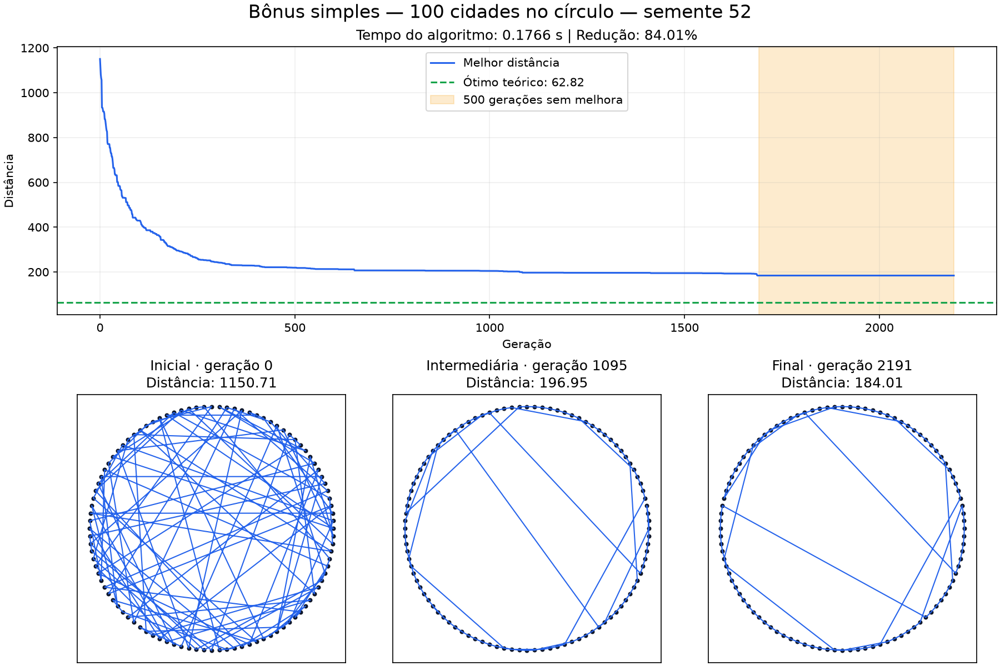

# 🧬 Algoritmo Genético para o Problema do Caixeiro Viajante (TSP)

> **PI: Sistemas Inteligentes e Aprendizado de Máquina (SIAM)**  
> **Pontifícia Universidade Católica de Campinas (PUC-Campinas)**  
> **Docente:** Prof. Fernando S. de Aguiar Neto  

---

## 👥 Integrantes do Grupo

O grupo de cinco integrantes é uma exceção autorizada pelo professor ao limite do enunciado.

* **Pedro Henrique Coan Zin**
* **Lucas Leal Ibrahim**
* **Renato Henrique Ykutake Florencio**
* **Felipe Ishizawa Diniz**
* **Eloise Dos Santos Ruiz**

Repositório Oficial: [github.com/eloruiz/caixeiro-viajante-genetico](https://github.com/eloruiz/caixeiro-viajante-genetico)

O algoritmo está implementado em **C++17**. Python executa os experimentos e gera gráficos e relatórios; HTML/JavaScript apenas reproduz os resultados já calculados. As instruções de execução, os parâmetros e os testes estão neste README.

---

## 📌 Sumário
1. [Visão Geral do Projeto](#-visão-geral-do-projeto)
2. [Definição do Problema (TSP 2D)](#-definição-do-problema-tsp-2d)
3. [Cenários de Teste](#-cenários-de-teste)
4. [Estrutura do Trabalho (Frentes Técnicas)](#-estrutura-do-trabalho-frentes-técnicas)
5. [Critérios de Avaliação e Entregas](#-critérios-de-avaliação-e-entregas)
6. [Implementação da parte 3](#implementação-da-parte-3)
7. [Compilar e executar](#compilar-e-executar)
8. [Dados para a parte 4](#dados-para-a-parte-4)
9. [Experimentos circulares e bônus](#experimentos-com-o-benchmark-circular-e-bônus-parte-5)
10. [Conferência do enunciado](#conferência-do-enunciado)
11. [Testes e resultados](#testes-e-resultados)

---

## 🎯 Visão Geral do Projeto

Este projeto tem como objetivo conceber, implementar e avaliar um **Algoritmo Genético (AG)** para encontrar soluções locais para o **Problema do Caixeiro Viajante (Traveling Salesperson Problem - TSP)** em espaço bidimensional ($\mathbb{R}^2$).

O foco da atividade não é a garantia matemática de um ótimo global, mas sim explorar a dinâmica bioinspirada do algoritmo, avaliando o comportamento da convergência, a capacidade de desatamento de cruzamentos de rotas e o desempenho das soluções encontradas ao longo das gerações/épocas.

---

## 🗺️ Definição do Problema (TSP 2D)

Dado um conjunto arbitrário de $N$ pontos no plano cartesiano ($N \ge 8$), onde cada ponto $p_i$ possui coordenadas $(x_i, y_i) \in \mathbb{R}^2$:

1. **Circuito Fechado**: A rota deve partir de um ponto inicial, visitar cada um dos demais pontos exatamente uma vez e retornar ao ponto de origem.
2. **Distância Euclidiana**: A distância entre dois pontos $p_a$ e $p_b$ é dada por:
   $$d(p_a, p_b) = \sqrt{(x_a - x_b)^2 + (y_a - y_b)^2}$$
3. **Função Objetivo**: Minimizar a extensão total do circuito $I = [c_0, c_1, \dots, c_{N-1}]$:
   $$D(I) = \left( \sum_{i=0}^{N-2} d(p_{c_i}, p_{c_{i+1}}) \right) + d(p_{c_{N-1}}, p_{c_0})$$

---

## 🧪 Cenários de Teste

O algoritmo foi avaliado sob duas configurações topológicas:

### 1. Pontos Uniformemente Distribuídos
* Pontos dispersos aleatoriamente em um plano bidimensional.
* **Propósito**: Avaliar a capacidade do algoritmo genético de explorar espaços menos estruturados, escapar de mínimos locais e desatar cruzamentos complexos de arestas.

### 2. Círculo de Pontos (Benchmark Analítico)
* $N$ pontos equidistantes dispostos ao longo do perímetro de uma circunferência de raio $R$:
  $$x_i = R \cdot \cos\left(\frac{2\pi i}{N}\right), \quad y_i = R \cdot \sin\left(\frac{2\pi i}{N}\right)$$
* **Propósito**: Como a solução ótima global é geometricamente conhecida (o perímetro do polígono regular convexo), este cenário funciona como **benchmark**. A distância mínima teórica é:
  $$D_{\text{ótimo}} = N \cdot 2R \sin\left(\frac{\pi}{N}\right)$$
* Permite calcular com precisão o erro relativo da solução encontrada pelo AG em relação à solução analítica ideal.

---

## 🧩 Estrutura do Trabalho (Frentes Técnicas)

Para assegurar uma abordagem modular e desacoplada, o projeto está organizado em 5 frentes de trabalho:

* **Frente 1 — Modelagem e Aptidão**: Geração das coordenadas para os dois cenários, implementação do cálculo de distâncias euclidianas do circuito fechado e definição da métrica de aptidão (*fitness*).
* **Frente 2 — Representação e Cruzamento**: Estruturação dos dados para representação válida de rotas (permutações sem repetição) e implementação de operadores de cruzamento (*crossover*) adequados ao TSP.
* **Frente 3 — Mecanismo Evolutivo e Parametrização**: Implementação da população inicial, operadores de seleção, taxas de mutação, transição entre gerações e definição dos critérios de parada.
* **Frente 4 — Experimentação no Cenário Aleatório**: Execução dos testes com pontos dispersos, acompanhamento do histórico de distâncias a cada época e geração de gráficos de convergência e visualização da rota.
* **Frente 5 — Experimentação no Benchmark Circular & Bônus**: Execução no cenário circular, comparação com o limite analítico, produção de visualizações por época e condução do teste de estresse de escala (alta quantidade de pontos com medição de tempo de convergência).

---

## 📋 Critérios de Avaliação e Entregas

Conforme especificado no enunciado da atividade:

| Critério | Peso | Descrição da Entrega |
| :--- | :---: | :--- |
| **Representação e Cruzamento** | 2,0 pts | Justificativa da codificação do gene e do operador de cruzamento adotado. |
| **Desempenho no Cenário Aleatório** | 2,5 pts | Acompanhamento e visualização da solução e do desempenho época a época. |
| **Desempenho no Cenário Circular** | 2,5 pts | Acompanhamento e visualização da evolução das rotas no benchmark circular. |
| **População e Critério de Parada** | 1,0 pt | Justificativa do dimensionamento da população e das regras de encerramento da busca. |
| **Taxa de Mutação** | 1,0 pt | Justificativa da escolha da frequência/probabilidade de mutação. |
| **Função de Aptidão** | 1,0 pt | Explicação matemática e conceitual da métrica de aptidão utilizada. |
| **Bônus (Opcional)** | Até 1,0 pt | Teste do modelo circular com alta quantidade de pontos, registrando tempo de convergência e rotas intermediárias. |

## Implementação da parte 3

A evolução integra as funções de distância e aptidão da parte 1 com a representação por permutação e o cruzamento OX da parte 2:

1. Cria a população inicial embaralhando os índices das cidades.
2. Avalia e ordena as rotas pela distância do circuito fechado.
3. Preserva a elite sem alterações na próxima geração.
4. Seleciona pais por torneio com reposição: vence a menor distância, equivalente à maior aptidão `1 / (1 + distância)`.
5. Aplica cruzamento OX e mutação por troca de duas posições distintas, conforme as probabilidades configuradas.
6. Repete o processo, registrando a melhor rota e as distâncias de cada geração.
7. Encerra pelo limite de gerações ou por gerações consecutivas sem melhora estrita.

O elitismo impede que a melhor distância piore. A busca não garante o ótimo global; parar por estagnação significa apenas que não houve melhora durante o intervalo configurado.

### Arquivos

| Arquivo | Responsabilidade |
| --- | --- |
| `include/problema.h`, `src/problema.cpp` | Pontos, cenários, distância e aptidão — parte 1. |
| `include/cruzamento.h`, `src/cruzamento.cpp` | Validação de permutações e cruzamento OX — parte 2. |
| `include/evolucao.h`, `src/evolucao.cpp` | Parâmetros, seleção, mutação, elitismo, gerações e histórico — parte 3. |
| `src/main.cpp` | Execução pelo terminal e exportação dos CSVs. |
| `testes/teste_*.cpp` | Testes do problema, cruzamento, evolução e requisitos. |
| `testes/executar_testes.ps1` | Compilação e execução da suíte no PowerShell. |
| `testes/teste_integracao.ps1` | Verificação da linha de comando e dos CSVs. |
| `Makefile` | Compilação e execução dos testes C++ em ambiente com shell compatível. |

O algoritmo e seus testes funcionais são escritos em C++17. Os scripts PowerShell automatizam a compilação e verificam a integração com os arquivos exportados.

### Parâmetros padrão

| Campo de `ParametrosEvolucao` | Padrão | Justificativa inicial |
| --- | ---: | --- |
| `tamanhoPopulacao` | 100 | Equilíbrio inicial entre diversidade e custo de avaliação. |
| `tamanhoTorneio` | 3 | Favorece boas rotas mantendo variedade na seleção. |
| `quantidadeElite` | 1 | Preserva a melhor rota e permite substituir as demais. |
| `taxaCruzamento` | 0,90 | Favorece recombinação, mantendo a possibilidade de copiar um pai. |
| `taxaMutacao` | 0,10 | Cada filho tem 10% de chance de trocar duas cidades; a taxa é por filho. |
| `maxGeracoes` | 1000 | Limita o custo da busca. |
| `limiteSemMelhora` | 200 | Encerra buscas estagnadas; zero desativa esse critério. |
| `semente` | 42 | Permite repetir experimentos na mesma implementação da biblioteca C++. |

### Justificativa da população, parada e mutação

A população 100 mantém várias rotas candidatas sem elevar tanto o custo de avaliação quanto uma população 200. Na comparação registrada em `experimentos/resultados/comparacao/resumo.csv`, populações 50, 100 e 200 atingiram a mesma distância final em cada uma das três sementes. Mantemos 100 como referência intermediária; os resultados não demonstram superioridade geral nem medem tempo de execução.

O teto de 1.000 gerações limita o custo. A parada após 200 gerações consecutivas sem melhora estrita evita continuar indefinidamente quando a melhor solução estabiliza. O elitismo preserva a melhor rota. Estagnação não comprova ótimo local nem global. No bônus simplificado de 100 cidades, usamos uma janela de 500 gerações e teto de 20.000, registrando o tempo até confirmar essa condição.

A mutação troca duas cidades distintas, preservando uma permutação válida e introduzindo variação que pode explorar rotas ausentes na população. Com probabilidade 0,10 por filho, a maioria dos filhos mantém a ordem produzida pelo cruzamento; entre 99 filhos não elitistas, esperam-se cerca de 9,9 mutações por geração, sem quantidade fixa. Foram comparadas taxas 0,05, 0,10 e 0,20 com população 100. Todas chegaram às mesmas distâncias finais nas três instâncias. As médias até parada foram 214,3, 219,3 e 219,0 gerações, respectivamente. Assim, 0,10 é uma referência conservada entre experimentos, não uma taxa comprovadamente ótima. Três instâncias de 12 cidades não sustentam generalizações para problemas maiores.

### Representação do indivíduo e escolha do cruzamento

Cada indivíduo é uma permutação dos índices das cidades; cada posição contém o índice da próxima cidade a visitar. O fechamento é implícito: a última cidade liga-se à primeira. Isso representa diretamente a ordem das visitas e permite verificar se cada cidade aparece exatamente uma vez.

Usamos Order Crossover (OX), pois um cruzamento comum de vetores pode repetir cidades e omitir outras. O OX copia um segmento do primeiro pai e preenche as demais posições, circularmente, na ordem do segundo pai, ignorando cidades já usadas. Assim, preserva parte da ordem relativa e produz uma permutação válida. Não garante preservar todas as boas arestas nem encontrar o ótimo.

Exemplo com oito cidades, cortes nas posições 2 a 4 (índices iniciados em zero):

```text
Pai 1: 0 1 [2 3 4] 5 6 7
Pai 2: 4 6 0 2 7 1 5 3
Filho: 0 7 [2 3 4] 1 5 6
```

Após copiar `2 3 4`, percorre-se o pai 2 a partir da posição 5 e preenchem-se as posições livres a partir da posição 5 do filho. Seleção por torneio de tamanho 3 favorece rotas menores; cruzamento 0,90 recombina a maioria dos filhos e elite 1 protege a melhor solução.

### Aptidão e sementes

A aptidão é `f = 1 / (1 + D)`, com `D` igual à distância euclidiana total, incluindo o retorno à origem. Ela é positiva e diminui quando a distância aumenta; o termo 1 evita divisão por zero. Por exemplo, distâncias 9 e 19 produzem aptidões 0,10 e 0,05. O torneio compara diretamente as distâncias, o que equivale a escolher a maior aptidão.

A semente **não precisa ser 42**. Ela inicializa o gerador pseudoaleatório e deve ser registrada para reproduzir os resultados no mesmo ambiente e implementação da biblioteca C++. Foram usadas 42, 123 e 456 para observar mais de uma execução. No aleatório, a semente altera tanto as coordenadas quanto a busca; no circular, os pontos permanecem iguais e a busca muda. Portanto, comparar distâncias absolutas entre sementes aleatórias não isola a qualidade do algoritmo. Não se deve escolher apenas a semente com o resultado mais favorável.

Pela API C++, todos os parâmetros podem ser alterados antes de chamar `executarEvolucao(pontos, parametros)`.

São necessários ao menos 8 pontos finitos, população de pelo menos 2, torneio entre 1 e o tamanho da população e elite entre 1 e população menos 1. As taxas devem estar entre 0 e 1, e os limites de gerações não podem ser negativos. Zero gerações retorna somente a população inicial.

## Compilar e executar

É necessário um compilador com suporte a **C++17**. Os comandos abaixo partem da pasta `caixeiro-viajante-genetico`.

### Windows / PowerShell

Neste computador, o g++ está instalado pelo MSYS2 em `C:\msys64\ucrt64\bin`. Se o compilador já estiver no PATH, a primeira linha é dispensável.

```powershell
$env:PATH = 'C:\msys64\ucrt64\bin;' + $env:PATH
New-Item -ItemType Directory -Force build | Out-Null
g++ -std=c++17 -Wall -Wextra -Wpedantic -Werror src/problema.cpp src/cruzamento.cpp src/evolucao.cpp src/main.cpp -o build/ag.exe
cd build
./ag.exe aleatorio 12 42
```

Para executar o cenário circular:

```powershell
./ag.exe circular 12 42
```

### Argumentos do programa

```text
ag [circular|aleatorio] [pontos] [semente] [populacao] [geracoes] [mutacao] [sem_melhora] [pasta_saida]
```

Todos os argumentos são opcionais, nessa ordem. Sem argumentos, o programa usa cenário circular, 12 pontos e os parâmetros padrão. A CLI aceita sementes inteiras de 0 a 2147483647 e taxas com ponto decimal, como `0.10`.

Exemplo com todos os argumentos:

```powershell
./ag.exe aleatorio 25 123 150 2000 0.15 300
```

Nesse exemplo, são usadas 25 cidades, semente 123, população 150, até 2000 gerações, mutação de 15% por filho e parada após 300 gerações sem melhora. Torneio, elite e taxa de cruzamento são configurados pela API C++, não por argumentos da CLI.

Na CLI, o círculo tem raio 10 e o cenário aleatório usa coordenadas entre 0 e 100 em cada eixo. Para modificar essas dimensões, use as funções de geração de pontos pela API C++ ou ajuste as chamadas em `src/main.cpp`.

## Dados para a parte 4

Cada execução grava dois arquivos **no diretório em que o programa foi executado**, ou na pasta de saída opcional (que deve existir):

| Arquivo | Colunas | Uso |
| --- | --- | --- |
| `historico.csv` | `geracao,melhor_distancia,distancia_media,rota` | Gráfico de convergência e acompanhamento da melhor rota por geração. |
| `pontos.csv` | `cidade,x,y` | Coordenadas para desenhar as cidades e ligar a rota. |

A geração 0 é a população inicial. Uma execução de 20 gerações exporta 21 registros de dados. A coluna `rota` contém índices separados por espaços, com cada cidade uma vez; para desenhar o circuito fechado, conecte também a última cidade à primeira.

**Uma nova execução na mesma pasta substitui os CSVs anteriores.** Para comparar sementes e parâmetros, execute em pastas diferentes. Exemplo a partir da raiz do projeto, após compilar:

```powershell
New-Item -ItemType Directory -Force build/experimento_aleatorio_42 | Out-Null
Push-Location build/experimento_aleatorio_42
../ag.exe aleatorio 12 42 100 1000 0.10 200
Pop-Location
```

Na API C++, `ResultadoEvolucao` fornece `melhorRota`, `melhorDistancia`, `motivoParada` e `historico`. Cada `RegistroGeracao` contém o número da geração, a melhor distância, a distância média e a melhor rota daquela geração.

### Resultados do cenário aleatório e visualização por época

Os experimentos usam 12 cidades, população 100, torneio 3, elite 1, OX 0,90,
mutação 0,10 por filho, teto de 1.000 gerações e parada após 200 sem melhora.

| Semente | Distância inicial | Distância final | Redução | Geração de parada |
| ---: | ---: | ---: | ---: | ---: |
| 42 | 519,3064 | 326,7457 | 37,08% | 223 |
| 123 | 297,8075 | 229,8839 | 22,81% | 216 |
| 456 | 466,0941 | 312,6760 | 32,92% | 219 |

Cada semente altera os pontos e a busca, portanto as distâncias absolutas entre sementes
não isolam a qualidade do algoritmo. A redução demonstra melhora, sem comprovar ótimo global.

Para mostrar a solução e o desempenho **a cada época**, abra um dos visualizadores:

- [Aleatório — semente 42](experimentos/resultados/semente_42/evolucao_rotas.html)
- [Aleatório — semente 123](experimentos/resultados/semente_123/evolucao_rotas.html)
- [Aleatório — semente 456](experimentos/resultados/semente_456/evolucao_rotas.html)

Use Reproduzir ou a barra de geração. A página mostra a rota fechada, a melhor distância
e a média da população, desde a geração 0 até a parada. Não precisa de servidor:
os HTMLs podem ser abertos diretamente no navegador. Para regenerar os gráficos e HTMLs
a partir dos CSVs existentes, instale matplotlib e execute `python experimentos/gerar_graficos.py`.
Para repetir a comparação de populações e mutações, compile o C++ e execute
`python experimentos/executar_comparacao.py`.

## Experimentos com o benchmark circular e bônus (parte 5)

A experimentação da parte 5 avalia o algoritmo genético no cenário circular com raio 10, comparando as soluções encontradas com a solução analítica ótima do polígono regular convexo:
$$D_{\text{ótimo}} = N \cdot 2R \sin\left(\frac{\pi}{N}\right)$$

### Geração das visualizações e execução automatizada

Os resultados circulares de 12 cidades estão disponíveis nos arquivos abaixo:

- [Circular — semente 42](experimentos/resultados/circular/semente_42/evolucao_rotas.html)
- [Circular — semente 123](experimentos/resultados/circular/semente_123/evolucao_rotas.html)
- [Circular — semente 456](experimentos/resultados/circular/semente_456/evolucao_rotas.html)

Cada HTML contém todas as épocas, com rota, melhor distância, média, ótimo teórico e erro.
Para o **bônus atual de 100 cidades**, use somente `python experimentos/bonus_simples.py`.
O script anterior `executar_parte5.py` mantém a reprodução dos experimentos históricos,
incluindo o bônus antigo de 200 cidades; não é necessário executá-lo para a apresentação simplificada.

### Análise dos experimentos circulares (N=12)

Foram executadas as sementes 42, 123 e 456 com 12 cidades em circunferência de raio 10 (parâmetros: população 100, mutação 0,10, parada após 200 gerações sem melhora).

| Semente | Distância inicial | Distância final | Ótimo teórico | Erro relativo | Gerações | Tempo (s) | Parada |
| ---: | ---: | ---: | ---: | ---: | ---: | ---: | --- |
| 42 | 127,6268 | 62,1166 | 62,1166 | 0,0000% | 235 | ~0,01 s | Estagnação |
| 123 | 129,4887 | 62,1166 | 62,1166 | 0,0000% | 212 | ~0,01 s | Estagnação |
| 456 | 122,6670 | 62,1166 | 62,1166 | 0,0000% | 214 | ~0,01 s | Estagnação |

Todas as sementes atingiram o ótimo analítico global com erro relativo de **0,0000%**, mostrando que estas execuções encontraram o circuito perimetral. Isso não garante o mesmo resultado para qualquer tamanho ou semente.

Cada pasta de semente em `experimentos/resultados/circular/` contém:

- `historico.csv` e `pontos.csv`: Dados numéricos da evolução e coordenadas dos pontos.
- `grafico_convergencia.png`: Curva da melhor distância e média populacional com a linha de referência do ótimo teórico analítico.
- `rotas_evolucao.png`: Painel comparativo mostrando o circuito inicial desordenado e o polígono final regular.
- `rota_final.png`: Imagem isolada da melhor rota final encontrada.
- `evolucao_rotas.html`: Visualizador interativo offline com reprodução automática, controle de velocidade (0.5x a 5x), alternador de rótulos das cidades e exibição do ótimo teórico e erro relativo em tempo real.

### Bônus simples: 100 cidades

A apresentação do bônus usa **100 cidades no círculo, semente 52 e população 100**.
O algoritmo permanece em C++; um único script Python compila, executa, confere os CSVs
e produz uma imagem com o gráfico e as rotas inicial, intermediária e final.

Na raiz do projeto, com g++ e Python instalados:

```powershell
python -m pip install matplotlib
python experimentos/bonus_simples.py
```

O script usa mutação 0,10 por filho, cruzamento OX 0,90, torneio 3 e elite 1.
A parada ocorre após 500 gerações sem melhora, com teto de segurança de 20.000.
O tempo é medido pelo C++ até a parada, excluindo compilação, exportação e gráficos.
Estagnação não garante ótimo global.

Os resultados e a explicação para a equipe estão em
[`bonus_100/LEIA-ME.md`](experimentos/resultados/bonus_100/LEIA-ME.md).
A imagem para apresentar é [`bonus_100/bonus.png`](experimentos/resultados/bonus_100/bonus.png).
Os parâmetros estão no início de `experimentos/bonus_simples.py`.

| Medida | Resultado registrado |
| --- | ---: |
| Cidades / semente / população | 100 / 52 / 100 |
| Distância inicial → final | 1.150,7070 → 184,0140 |
| Redução | 84,01% |
| Última melhora / parada | 1.691 / 2.191 |
| Tempo até confirmar estagnação | 0,1766 s |
| Ótimo analítico / erro final | 62,8215 / 192,92% |



O tempo depende do computador e da compilação (`-O2` nesta execução).
100 cidades é a escolha de escala deste trabalho; o enunciado não fixa mínimo para
“quantidade alta”. O teste mostra estabilização da melhor distância, não alcance do ótimo.
A nota máxima permanece 10; conforme o enunciado, o bônus pode compensar falhas nos outros critérios.
As execuções anteriores de 200 cidades ficam como histórico; não são necessárias para apresentar este bônus.

### Origem dos resultados circulares

Os artefatos circulares versionados e a tabela da parte 5 registram 235, 212 e 214 gerações. A execução local com GCC/MSYS2 no Windows, semente 42 e mesmos parâmetros, encerrou em 213 gerações e atingiu a mesma distância ótima. A reprodução de sequências de distribuições e embaralhamentos da biblioteca padrão C++ depende da implementação; não se deve misturar o histórico de um ambiente com o número de gerações de outro. Os exemplos abaixo identificam a execução local; a tabela da parte 5 descreve os CSVs versionados.

## Visualização interativa

As animações compartilham o mesmo painel: métricas da geração, rota e gráfico lado a lado,
reprodução/pausa, reinício, resultado final, velocidade e seleção de qualquer geração.
O layout se adapta a telas menores e não depende de internet ou bibliotecas JavaScript externas.
O gráfico acompanha somente os dados até a geração selecionada; a referência do ótimo aparece apenas no círculo.

Para aplicar novamente o visual aos HTMLs existentes, sem executar o algoritmo nem alterar os CSVs:

```powershell
python experimentos/atualizar_visual.py
```

O modelo fica em `experimentos/visualizador.html` e o gerador em `experimentos/visualizacao.py`.
Os scripts de gráficos e o bônus usam esse mesmo modelo ao gerar novas páginas.
O bônus simples também gera `experimentos/resultados/bonus_100/evolucao_rotas.html` para reprodução opcional.

## Conferência do enunciado

| Exigência da atividade | Onde está atendida |
| --- | --- |
| Algoritmo genético parametrizado | `include/evolucao.h`, `src/evolucao.cpp` e tabela de parâmetros |
| Pontos 2D, distância euclidiana e circuito fechado | `src/problema.cpp` e testes de recálculo da rota |
| Quantidade arbitrária, mínimo de 8 pontos | Argumento `pontos` e validações nos geradores e na evolução |
| Cenários uniforme e circular | Geradores C++ e experimentos dos dois cenários |
| Explicar população e parada (1 ponto) | Seção de justificativas e comparação registrada em `comparacao/resumo.csv` |
| Explicar mutação (1 ponto) | Probabilidade por filho, preservação da permutação e comparação 0,05/0,10/0,20 |
| Explicar representação e cruzamento (2 pontos) | Permutação e exemplo completo do OX |
| Explicar aptidão (1 ponto) | Fórmula `1 / (1 + D)` e exemplo numérico |
| Solução e desempenho por época no aleatório (2,5 pontos) | CSVs completos e três HTMLs com rota, melhor distância e média |
| Solução e desempenho por época no circular (2,5 pontos) | CSVs completos e três HTMLs com benchmark analítico |
| Bônus: escala, tempo e rotas intermediárias (até 1 ponto) | `bonus_100/LEIA-ME.md`, `bonus.png`, histórico e saída do C++ |
| Grupo de até 4 pessoas | Exceção para cinco integrantes autorizada pelo professor, informada pela equipe |

## Testes e resultados

Para compilar o programa e executar todos os testes no PowerShell, a partir da raiz do projeto:

```powershell
$env:PATH = 'C:\msys64\ucrt64\bin;' + $env:PATH
./testes/executar_testes.ps1
```

O script usa `-Wall -Wextra -Wpedantic -Werror` e interrompe em caso de falha. Os binários e as saídas dos testes ficam em `build/`, que é ignorada pelo Git. Eles podem ser recriados pelo script após uma limpeza.

| Conjunto | O que verifica |
| --- | --- |
| `teste_problema.cpp` | Distância, fechamento da rota, aptidão, círculo e pontos uniformes. |
| `teste_cruzamento.cpp` | Validação de permutações, 1000 cruzamentos e pais iguais. |
| `teste_evolucao.cpp` | Histórico, elitismo, reprodução por semente, ótimo circular de 8 cidades, critérios de parada, taxas 0 e 1, população ímpar, 20 sementes e entradas inválidas. |
| `teste_requisitos.cpp` | 48 combinações de cenário/tamanho/parâmetros/semente, cálculo independente do circuito, referência exata para 8 cidades, aptidão, 1000 cruzamentos adicionais e escala de 500 cidades. |
| `teste_integracao.ps1` | Execução dos dois cenários pela CLI, recálculo das distâncias nos CSVs, reprodução do histórico e rejeição de 11 argumentos inválidos. |

A suíte completa passou novamente na validação de **28/10/2026**, usando GCC do MSYS2 e PowerShell. Também foi verificada a rejeição de 12 entradas inválidas na evolução e de 14 nos geradores de pontos.

Em ambientes com make e shell compatível, `make teste` inclui os quatro conjuntos C++; os testes de integração PowerShell são executados pelo script acima. Neste ambiente, `make.exe` abortou antes da compilação com erro de acesso do MSYS2 (`NtCreateDirectoryObject`, `0xC0000022`); a validação efetiva foi feita pelo PowerShell.

### Exemplos observados

Execuções com 12 cidades, semente 42 e demais parâmetros padrão:

| Cenário | Melhor distância inicial | Melhor distância final | Gerações executadas |
| --- | ---: | ---: | ---: |
| Circular, raio 10 | 127,6268 | 62,1166 | 213 |
| Aleatório, limite 100 | 519,3064 | 326,7457 | 223 |

O círculo atingiu o ótimo conhecido na geração 13 e encerrou após 200 gerações sem melhora. O resultado aleatório demonstra redução da distância, sem comprovar ótimo global.

Um teste funcional adicional, separado do bônus apresentado, com 500 cidades circulares, população 100 e 50 gerações levou aproximadamente 0,32 s no ambiente usado. A distância caiu de aproximadamente 6064,97 para 4548,47, ainda muito acima do ótimo de 62,8314. Esse teste valida a execução nessa escala; não mede tempo até convergência nem comprova o bônus do trabalho.
